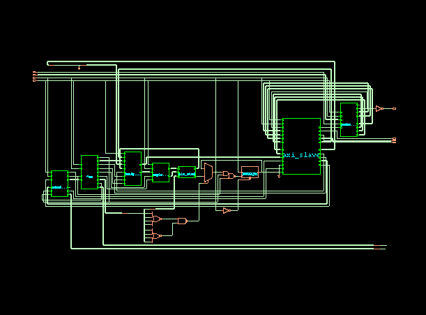

<div align="center">
  

  # Mini GPU SIMD

  **Projeto e verificação de uma unidade de processamento vetorial em SystemVerilog**

  Projeto Final · CI Digital — Fase 2
</div>

A Mini GPU é uma unidade de processamento vetorial simplificada que aplica a mesma operação a quatro pares de elementos em paralelo, seguindo o paradigma **SIMD** (*Single Instruction, Multiple Data*). O projeto reúne implementação RTL, testbenches, verificação UVM, síntese e simulação da netlist.

## Visão geral

| Característica | Implementação |
|---|---|
| Unidades aritméticas | 4 lanes de 16 bits, com operações signed |
| Operações | `ADD`, `SUB`, `MUL` e `DIV` |
| Entrada do host | 4 elementos signed de 8 bits por vetor |
| Memória vetorial | 256 palavras de 64 bits, com duas portas |
| Interface | Requisições de 42 bits e respostas de 64 bits |
| Tratamento de erro | Divisão por zero e overflow signed sinalizados em `rsp_error` |
| Comandos | Uma operação em execução por vez |

Os elementos escritos pelo host são estendidos com sinal para 16 bits. A memória também armazena resultados intermediários, que podem ser usados em operações seguintes. O resultado de uma operação é gravado no endereço de destino e pode ser lido pelo host.

## Arquitetura

O **Packet Decoder** recebe as requisições e separa seus campos. O módulo `axi_slave` interpreta os pacotes, atende aos acessos à memória e encaminha os comandos ao **Scheduler**. Uma **FSM** coordena a leitura dos operandos, o carregamento dos registradores vetoriais, a operação da ALU SIMD e a escrita do resultado.

Apesar do nome `axi_slave`, a interface implementada usa um protocolo próprio de pacotes e handshake; ela não expõe os canais de um barramento AXI4-Lite.

<div align="center">
  
  <p><em>Esquemático exportado da netlist sintetizada no Cadence Genus.</em></p>
</div>

### Protocolo de requisições

O host envia um pacote formado por `TYPE[1:0]` e cinco campos de 8 bits. As requisições são aceitas por handshake `req_valid`/`req_ready`; a resposta é indicada por `rsp_valid`.

| Tipo | Requisição | Função |
|---|---|---|
| `00` | `MEM_READ` | Lê uma palavra da memória vetorial. |
| `01` | `MEM_WRITE` | Escreve quatro elementos de 8 bits na memória. |
| `10` | `GPU_COMMAND` | Configura opcode e endereços dos operandos e destino. |
| `11` | `GPU_START` | Inicia o comando e responde após sua conclusão. |

A resposta de `GPU_START` informa o estado da execução e eventuais erros aritméticos. O vetor resultante é obtido com uma requisição `MEM_READ` ao endereço de destino.

## Verificação

Cada bloco possui testbench próprio, e a GPU integrada também é testada por operações vetoriais e multiplicação de matrizes 4×4. O ambiente **UVM** inclui sequências, driver, monitor, agent, scoreboard, cobertura funcional e assertions de protocolo, Scheduler e FSM.

A sequência de multiplicação matricial organiza os operandos em vetores e combina instruções SIMD `MUL` e `ADD`; cada lane acumula um elemento da linha resultante. A campanha inclui ainda testes de reset, endereços de borda, operações consecutivas e estímulos aleatórios.

Nos registros da campanha, os 17 testes UVM apresentaram **zero `UVM_ERROR` e `UVM_FATAL`**. O relatório consolidado do IMC registrou:

- **100% de cobertura funcional:** 44 de 44 itens definidos no modelo de cobertura.
- **97,72% de código coberto:** 643 de 658 itens na linha `gpu_top_tb.dut`; os módulos internos são apresentados separadamente no relatório.

Os percentuais dependem dos itens definidos e medidos na campanha; não representam todas as combinações possíveis de entrada. Consulte [COVERAGE/README.md](COVERAGE/README.md) para os comandos de execução e análise.

### Executar um teste UVM

Com o Cadence Xcelium disponível, execute na raiz do projeto:

```bash
xrun -uvm -define ASSERTIONS -access +rw -f UVM/gpu/files.f \
  +UVM_TESTNAME=test_gpu_add_end_to_end -run -exit
```

Para executar a multiplicação de matrizes, substitua o nome do teste por `gpu_matrix_mul_test`. A lista de testes e as opções de execução estão em [UVM/README.md](UVM/README.md).

## Síntese e análise temporal

O fluxo de síntese utiliza o **Cadence Genus** e a biblioteca GPDK045 no canto lento, com 0,9 V e 125 °C. Os resultados registrados para a restrição de clock de 20 ns são estimativas da netlist sintetizada, anteriores à implementação física:

| Métrica | Resultado registrado |
|---|---|
| Clock | 20 ns / 50 MHz |
| Instâncias mapeadas | 81.398 células |
| Área total de células | 204.149,034 unidades de área da biblioteca |
| Slack de setup do caminho crítico | Aproximadamente +2,836 ns |
| Área da memória | Aproximadamente 92,26% da área de células |

A memória foi inferida com células padrão, pois o fluxo não utiliza uma macro SRAM compatível. A simulação funcional da netlist e a simulação temporal com SDF são documentadas em [SIMULACAO_NETLIST](SIMULACAO_NETLIST/). A execução temporal registrada concluiu sem violações de timing, com avisos de `REMOVAL` associados aos modelos da biblioteca.

Os scripts e relatórios estão em [SINTESE](SINTESE/). Os fluxos de síntese e de simulação da netlist dependem das ferramentas Cadence e da biblioteca de células configuradas no ambiente de laboratório.

## Estrutura do repositório

```text
Mini_GPU/
├── ALU_UNIT/          # Unidade aritmética de uma lane
├── ALU_SIMD/          # Quatro lanes aritméticas
├── AXI_SLAVE/         # Interpretação das requisições do host
├── DUALPORT_MEMORY/   # Memória vetorial de duas portas
├── FSM/               # Controle da execução SIMD
├── GPU_SIMD/          # Integração RTL e testbenches da GPU
├── PACKET_DECODER/    # Recepção e extração dos campos dos pacotes
├── REGISTER_VECTOR/   # Registradores dos operandos vetoriais
├── SCHEDULER/         # Despacho e estado dos comandos
├── UVM/               # Ambiente, sequências, testes e assertions
├── COVERAGE/          # Scripts e registros de cobertura
├── SINTESE/           # Fluxo de síntese, netlist e relatórios
├── SIMULACAO_NETLIST/ # Simulação funcional e temporal com SDF
└── docs/              # Documentos, PDFs e imagens do projeto
```

## Documentação

- [Relatório final do projeto](docs/GPU_final.pdf)
- [Especificação e plano de verificação](docs/GPUArchiteture.pdf)
- [Guia do ambiente UVM](UVM/README.md)
- [Fluxo de síntese](SINTESE/README.md)
- [Simulação funcional da netlist](SIMULACAO_NETLIST/funcionamento/README.md)
- [Simulação temporal com SDF](SIMULACAO_NETLIST/timing/README.md)

---

**Vinícius Carvalho Pimpim** · Projeto Final — CI Digital
